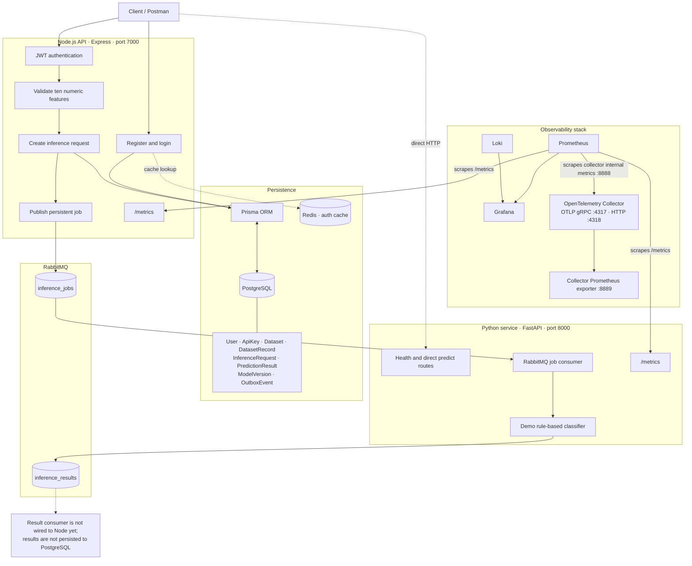

# InferenceFlow

<p align="center">
  <strong>Asynchronous Gamma/Hadron inference API with a Python worker and an observability stack.</strong>
</p>

<p align="center">
  <a href="https://nodejs.org/"></a>
  <a href="https://expressjs.com/"></a>
  <a href="https://www.python.org/"></a>
  <a href="https://fastapi.tiangolo.com/"></a>
  <a href="https://www.prisma.io/"></a>
  <a href="https://www.postgresql.org/"></a>
  <a href="https://www.rabbitmq.com/"></a>
  <a href="https://prometheus.io/"></a>
  <a href="https://grafana.com/"></a>
  <a href="https://grafana.com/oss/loki/"></a>
  <a href="https://opentelemetry.io/"></a>
  <a href="https://www.docker.com/"></a>
</p>

## Overview

InferenceFlow is a backend project for submitting telescope-observation features, persisting prediction requests, and dispatching work asynchronously. An Express API validates requests and publishes jobs to RabbitMQ. A FastAPI-hosted Python service consumes jobs and applies a simple demonstration heuristic, then publishes a message to a result queue.

The project also includes a Docker Compose observability stack with Prometheus, Grafana, Loki, and an OpenTelemetry Collector.

> **Important:** The current classifier is a demo heuristic, not a trained Gamma/Hadron model. No ONNX inference is performed. The worker publishes result messages, but the Node API does not currently consume those messages or persist prediction results to PostgreSQL.

## Contents

- [Architecture](#architecture)
- [Technology stack](#technology-stack)
- [Current capabilities and limitations](#current-capabilities-and-limitations)
- [Repository layout](#repository-layout)
- [Requirements](#requirements)
- [Configuration](#configuration)
- [Run locally](#run-locally)
- [Run with Docker Compose](#run-with-docker-compose)
- [API reference](#api-reference)
- [Observability](#observability)
- [Tests](#tests)
- [Security notes](#security-notes)

## Architecture



### Prediction message flow

1. A client submits a bearer-authenticated prediction request to the Node API.
2. The API validates the ten numeric features, creates an `InferenceRequest` row, and publishes a persistent message to `inference_jobs`.
3. The Python worker consumes the job and runs the demo heuristic.
4. The Python worker publishes its output to `inference_results`.
5. **Current boundary:** a result consumer is not started by the API, so the result queue is not yet reflected in the request row or stored as a `PredictionResult`.

## Technology stack

| Area | Technologies | Role |
|---|---|---|
| API runtime | Node.js, Express | REST API, authentication endpoints, and prediction request handling |
| Python service | Python, FastAPI, Uvicorn | Health/direct-predict HTTP endpoints and RabbitMQ worker process |
| Database | PostgreSQL, Prisma ORM, `pg` | Relational persistence and database access |
| Messaging | RabbitMQ, `amqplib`, `pika` | Asynchronous prediction jobs and result messages |
| Authentication | JSON Web Token, `jsonwebtoken`, bcrypt | Bearer-token authentication and password hashing |
| Metrics | Prometheus, `prom-client`, `prometheus-client` | HTTP and Python inference metrics |
| Dashboards | Grafana | Provisioned Prometheus and Loki datasources and overview dashboard |
| Logs | Loki | Log-storage service included in the Compose stack |
| Telemetry | OpenTelemetry Collector | OTLP receiver and Prometheus metrics exporter |
| Cache | Redis | Redis client configuration used by the auth code |
| Infrastructure | Docker, Docker Compose | Container definitions for application and observability services |
| Tests | Node.js built-in test runner | JavaScript tests invoked by `npm test` |

Other packages are declared in `package.json` for application support or future use, including Zod, Multer, CORS, Helmet, Morgan, and rate-limiting packages. Their presence as dependencies does not imply they are all active in every current request path.

## Current capabilities and limitations

### Implemented

- Registration and login endpoints with bcrypt password hashing and JWT access tokens.
- JWT-protected `/me` and prediction endpoints.
- Per-user prediction request listing and lookup.
- Validation of ten finite numeric features in the required order.
- Prediction request persistence before RabbitMQ publishing.
- Durable RabbitMQ job and result queues with persistent job messages.
- A simple Python rule-based demonstration classifier.
- Node and Python Prometheus metrics endpoints.
- Docker Compose definitions and Grafana datasource/dashboard provisioning.

### Not implemented or not production-ready

- The demo heuristic is **not trained or scientifically validated** and its output should not be used for scientific conclusions.
- No ONNX model is loaded or used.
- The result queue is not consumed by Node; database status/result updates after worker execution are not wired up.
- Loki is provisioned as a Grafana datasource, but there is no log shipper configured to send application logs to Loki.
- OpenTelemetry accepts OTLP data, but Node/Python application trace instrumentation and OTLP export are not configured.
- The Compose file is a development starting point. Container networking and credentials must be reviewed for the environment before relying on it; local `.env` values using `localhost` do not automatically work between containers.

## Repository layout

```text
InferenceFlow/
├── prisma/
│   ├── migrations/                 # Database migration history
│   └── schema.prisma               # User, inference, dataset, and result models
├── src/
│   ├── config/                     # Redis connection
│   ├── controller/authcontroller/  # Registration and login handlers
│   ├── controllers/                # Prediction request handlers
│   ├── lib/                        # Prisma client
│   ├── middlewares/                # Authentication and role checks
│   ├── routes/                     # Auth and prediction routes
│   ├── services/                   # RabbitMQ publisher/consumer helpers
│   ├── tests/                      # Node test runner tests
│   └── server.js                   # Express application and metrics endpoint
├── Python-Backend/
│   ├── src/python_backend/main.py  # FastAPI app and RabbitMQ worker
│   ├── pyproject.toml              # Python package and dependencies
│   └── Dockerfile
├── grafana/provisioning/           # Grafana datasources and dashboard
├── loki/                           # Loki configuration
├── otel/                           # OpenTelemetry Collector configuration
├── prometheus/                     # Prometheus scrape configuration
├── docker-compose.yml
├── Dockerfile
└── README.md
```

## Requirements

For running services directly on your machine:

- Node.js 20 or later
- Python 3.11 or later
- PostgreSQL
- RabbitMQ
- Redis (needed by the current Redis integration)

For the container stack:

- Docker Desktop or Docker Engine with the Compose plugin

## Configuration

Create a root `.env` file. Do not commit credentials or production secrets.

| Variable | Purpose |
|---|---|
| `PORT` | Node API port; defaults to `7000` |
| `DATABASE_URL` | PostgreSQL connection string used by Prisma |
| `JWT_SECRET` | Secret used to sign and verify JWTs; use a strong unique value |
| `REDIS_URL` | Redis connection URL |
| `RABBITMQ_URL` | RabbitMQ AMQP connection URL |
| `PYTHON_BACKEND_URL` | Optional base URL for the Python service; currently not used by the API request flow |

Example values for a local development environment (replace placeholders with your own values):

```dotenv
PORT=7000
DATABASE_URL=postgresql://<user>:<password>@localhost:5432/<database>?schema=public
JWT_SECRET=<long-random-secret>
REDIS_URL=redis://localhost:6379
RABBITMQ_URL=amqp://<user>:<password>@localhost:5672
PYTHON_BACKEND_URL=http://localhost:8000
```

For local processes, service URLs generally point to `localhost` and the ports configured for each dependency. For containers, use Docker Compose service names (such as `postgres`, `redis`, and `rabbitmq`) as network hosts and configure the application containers accordingly.

## Run locally

Start PostgreSQL, Redis, and RabbitMQ, then configure the root `.env` file with their connection URLs.

### Node.js API

From the repository root:

```bash
npm install
npx prisma migrate deploy
npm start
```

Development mode with automatic restart:

```bash
npm run dev
```

### Python service and worker

From the repository root:

```bash
cd Python-Backend
python -m venv .venv
```

Activate the virtual environment and install the project:

```powershell
.\.venv\Scripts\Activate.ps1
python -m pip install -e .
```

Start FastAPI/Uvicorn:

```bash
python -m uvicorn python_backend.main:app --host 0.0.0.0 --port 8000
```

The Python process also starts a background RabbitMQ consumer. The current consumer connection settings are local-development oriented; configure them for your RabbitMQ deployment before containerizing or deploying the worker.

## Run with Docker Compose

The repository includes service definitions for PostgreSQL, Redis, RabbitMQ, the Node API, the Python worker, Prometheus, Loki, the OpenTelemetry Collector, and Grafana.

```bash
docker compose config
docker compose up --build -d
docker compose ps
```

The Compose file is a development scaffold, not a production deployment configuration. In particular, verify service-to-service URLs, database migration setup, credentials, health checks, and worker connectivity before expecting the complete request-to-result flow to work inside containers.

To stop the services:

```bash
docker compose down
```

Use `docker compose down -v` only when you intentionally want to delete the persisted Compose volumes and their data.

## API reference

The API listens on port `7000` by default. Auth routes are mounted at both `/auth` and `/api/v1/auth`; prediction routes are mounted at `/api/v1/predictions`.

### Authentication

| Method | Path | Auth | Purpose |
|---|---|---|---|
| `GET` | `/` | No | API health response |
| `GET` | `/auth/health` | No | Auth router health response |
| `POST` | `/auth/register` | No | Register a user |
| `POST` | `/auth/login` | No | Log in and receive a JWT |
| `GET` | `/auth/me` | Bearer token | Return the authenticated user |

The same auth routes are available under `/api/v1/auth`.

Registration request:

```json
{
  "name": "Example User",
  "email": "user@example.com",
  "password": "replace-with-a-strong-password"
}
```

Login request:

```json
{
  "email": "user@example.com",
  "password": "replace-with-a-strong-password"
}
```

Send the returned token to protected routes as:

```http
Authorization: Bearer <access-token>
```

### Predictions

| Method | Path | Auth | Purpose |
|---|---|---|---|
| `POST` | `/api/v1/predictions` | Bearer token | Validate, persist, and enqueue a prediction request |
| `GET` | `/api/v1/predictions` | Bearer token | List the current user's prediction requests |
| `GET` | `/api/v1/predictions/:id` | Bearer token | Retrieve one of the current user's requests |

Prediction request body (features must be finite JSON numbers):

```json
{
  "features": [28.8, 3.2, 2.0, 0.3, 0.1, 1.4, 8.2, -3.1, 40.0, 100.0]
}
```

The required feature order is:

1. `fLength`
2. `fWidth`
3. `fSize`
4. `fConc`
5. `fConc1`
6. `fAsym`
7. `fM3Long`
8. `fM3Trans`
9. `fAlpha`
10. `fDist`

Replace the sample values with numeric values from your input dataset. On successful enqueue, the API responds with HTTP `202 Accepted` and a request ID. If RabbitMQ is unavailable, the request is marked failed and the API returns HTTP `503`.

### Python service

| Method | Path | Purpose |
|---|---|---|
| `GET` | `/` | Worker service information |
| `GET` | `/health` | Health check |
| `GET` | `/metrics` | Prometheus metrics |
| `POST` | `/predict` | Run the direct demo heuristic |

Direct prediction request:

```json
{
  "features": [1, 2, 3, 4, 5, 6, 7, 8, 9, 10]
}
```

## Observability

| Service | Local URL | Purpose |
|---|---|---|
| Grafana | [http://localhost:3000](http://localhost:3000) | Dashboards and data exploration |
| Prometheus | [http://localhost:9090](http://localhost:9090) | Metrics collection and queries |
| Loki | [http://localhost:3100](http://localhost:3100) | Log storage endpoint |
| OpenTelemetry Collector | OTLP gRPC `localhost:4317`; OTLP HTTP `localhost:4318` | OTLP ingestion |
| Node metrics | [http://localhost:7000/metrics](http://localhost:7000/metrics) | Express and Node runtime metrics |
| Python metrics | [http://localhost:8000/metrics](http://localhost:8000/metrics) | Python request and inference-latency metrics |

Grafana is provisioned with Prometheus and Loki datasources and an `InferenceFlow Overview` dashboard. Prometheus scrapes the Node and Python metrics endpoints. The Collector configuration accepts OTLP and exposes a Prometheus exporter. Application log forwarding to Loki and application trace instrumentation are not currently configured.

The Compose Grafana credentials are intended only for local development. Change them and secure all observability endpoints before exposing the stack to a network.

## Tests

Run the Node.js tests from the repository root:

```bash
npm test
```

Check Python syntax:

```bash
python -m py_compile Python-Backend\src\python_backend\main.py
```

## Security notes

- Never commit `.env` files, JWT secrets, database passwords, or production credentials.
- Replace development credentials before running the stack beyond a local machine.
- Restrict access to `/metrics`, Grafana, Prometheus, Loki, RabbitMQ management, and OTLP receiver ports in deployed environments.
- Apply suitable authentication, TLS, and network policies before production use.
- Treat the current heuristic output as a demo only; it is not a validated scientific prediction.

## License

No project license is currently specified. Add a `LICENSE` file before redistributing this repository under a particular license.
